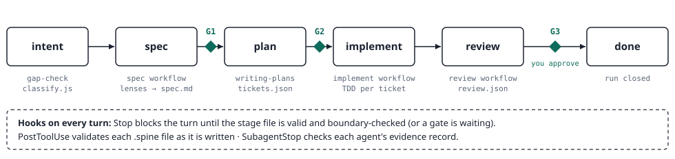

# spine

> **Status: alpha (0.3.2).** Commands, artifact shapes and gate behaviour may
> change between minor versions. `master` is the alpha channel; pin `v0.3.2`
> for a fixed version.

A gated, evidence-first engineering process for Claude Code. One plugin that
decides which of your installed process skills run for a task, forces artifact
boundaries between stages, cross-reviews with providers from different
authors, and renders a fixed six-line summary so you can follow along.

Runs in Claude Code and, experimentally, in Cursor. Requires Node 22 or newer on `PATH`.

## Install

```bash
claude plugin marketplace add rassim-medkour/spine
claude plugin install spine@spine
```

### Updating

spine does not update itself by default. Claude Code turns auto-update on
only for Anthropic's official marketplace, and spine is a third-party
marketplace. Pick one:

- **Turn on auto-update (recommended while spine is alpha):** run `/plugin`,
  open **Marketplaces**, select `spine`, and enable auto-update. New
  versions then install when Claude Code starts.
- **Update by hand:** run `claude plugin marketplace update spine`, then
  restart Claude Code.

Either way, a running session keeps the old version until you restart. Check
the [releases page](https://github.com/rassim-medkour/spine/releases) for
what changed.

Pin a version instead with
`claude plugin marketplace add https://github.com/rassim-medkour/spine.git#v0.3.2`.
Remove spine with `claude plugin uninstall spine@spine` and
`claude plugin marketplace remove spine`.

## Cursor (experimental)

spine also installs in the Cursor IDE as a plugin from this repository. It
runs on your normal Cursor plan; there is no API key and no extra billing.

**Status: experimental.** Cursor support is built from Cursor's documentation
and has NOT yet been tested in a live Cursor agent session. Expect rough
edges and please report them.

1. In Cursor, open **Customize > Marketplace** and add this repository by
   pasting `https://github.com/rassim-medkour/spine`. Use only this URL.
2. Reload the window and check that spine's hooks are listed.

Installing a plugin runs its hook scripts with your user privileges. Read
`hooks/cursor-hooks.json` and `scripts/cursor/` before installing.

Start a run in Agent chat by asking for the Spine skill with an entry point
(`intent`, `adopt`, `implement`, `review`, `status` or `resume`). Artifacts and
the summary block match Claude Code, and a run started in one host can be
resumed in the other. Drive a run from one host at a time: `state.json`
records the last host and spine warns when it changes.

Known limits in Cursor:

- The stop gate cannot block a turn. It re-prompts the agent
  up to 3 times instead of blocking, then shows a warning and writes a `Stop cap-reached`
  record that `status` reports. It never re-prompts while spine waits for your
  gate answer.
- Gates are advisory and approval is honor-system, as in Claude Code: only your
  own message in chat approves G1, G2 or G3.
- There is no Workflow-tool fan-out. Spine fans out to parallel subagents by
  prompt instead.
- Spine reads the models your Cursor install lists from local app state,
  read-only, and falls back to the session model when it cannot; a Cursor
  subagent may still run on the session model.
- How imported Claude skills are named in Cursor is unverified, so spine falls
  back to generic subagents when it cannot resolve a provider.
- Hook behavior was cross-checked against the Cursor 3.23.12 app bundle (a
  leading byte-order mark on stdin on Windows, and stop and subagentStop running
  from the workspace folder), but it has still not been tested in a live agent
  session.
- To keep the reminders but drop the re-prompts, set `"strictness": "warn"` in
  `~/.spine/config.json`.

## Companion plugins

spine routes work to other plugins. Install the ones you want; any that are
missing are reported at session start (`spine: missing plugins: ...`) and
skipped. When a provider is missing, spine picks the next-ranked provider
from a different author; when a stage has no provider left, spine drafts
that stage inline. spine runs with none of them installed, with less
cross-review.

<!-- deps:required:start -->
| Plugin | Install | Used for | Without it |
|---|---|---|---|
| `ecc` | `claude plugin marketplace add affaan-m/ECC` then `claude plugin install ecc@ecc` | spec, plan, implement, review providers | top-ranked provider at every stage is skipped |
| `superpowers` | `claude plugin install superpowers@claude-plugins-official` | spec brainstorming, plan writing, subagent implement, code review | plan stage falls back to ecc planners or inline |
| `mattpocock-skills` | `claude plugin install mattpocock-skills@claude-plugins-official` | spec grilling, domain modeling, TDD, standards/spec review | second-author spec and review provider is lost |
| `code-review` | `claude plugin install code-review@claude-plugins-official` | low-noise review provider | one fewer review provider |
| `feature-dev` | `claude plugin install feature-dev@claude-plugins-official` | bug and logic review agent | one fewer review provider |
| `caveman` | `claude plugin marketplace add JuliusBrussee/caveman` then `claude plugin install caveman@caveman` | terse severity-tagged review agent | lowest-ranked review provider is lost |
<!-- deps:required:end -->

Optional (not checked at session start):

<!-- deps:optional:start -->
| Plugin | Install | Why |
|---|---|---|
| `i-have-adhd` | `claude plugin marketplace add ayghri/i-have-adhd` then `claude plugin install i-have-adhd@i-have-adhd` | the summary block follows its shape; spine works without it |
<!-- deps:optional:end -->

Rows with only an `install` command come from `claude-plugins-official`, the
marketplace Claude Code ships with, so they need no `marketplace add`.
Every `<plugin>@<marketplace>` key above matches a working install on the
maintainer's machine, and each `marketplace add` source matches that
machine's marketplace configuration. The rows have not been re-run on a clean
machine for this alpha; if one fails, please report it (see Reporting issues).

## What this plugin runs

Four hooks, all local Node scripts. They make no network calls.

| Hook | Script | Purpose |
|---|---|---|
| `SessionStart` | `scripts/session-start.js` | reports missing companion plugins |
| `Stop` | `scripts/stop-gate.js` | blocks the turn until the stage boundary check passes |
| `SubagentStop` | `scripts/subagent-gate.js` | same check for subagents |
| `PostToolUse` | `scripts/validate-artifact.js` | validates artifacts after Edit, Write and MultiEdit |

State is written to `.spine/` in your repo (runs, artifacts, `hooks.log`) and
read from `~/.spine/config.json` and `<repo>/.spine/config.json`.

Node 22 or newer must be on `PATH`. Without it the hooks fail with exit code
127 (command not found); this is noisy but does not block your session.

If a hook script itself errors (an internal exception), it exits 0 and prints
a `spine:` message to stderr; the gates let the stop through rather than
trapping you.

Escape hatch: set `"strictness": "warn"` in `~/.spine/config.json` or
`<repo>/.spine/config.json` and the gates warn instead of blocking. To close a
run, set `status` to `"paused"` in `.spine/<run-id>/state.json`; the Stop hook
only gates runs whose status is `active`.

## Workflow tool

Size L specs, and implement and review at sizes M and L, use Claude Code's
Workflow tool. You can tell it is unavailable when the tool is not in the
tool list, or a call to it is refused or errors before any agent runs. spine
then does not stop: it runs that stage on the size S inline path (one provider
inline, findings verified by a different author), writes an INFO record with
the claim `workflow tool unavailable, ran inline`, and keeps the gate chain.

## Entry points

```
/spine:spine intent "<what you want>"
/spine:spine adopt <spec.md | tickets.json | issue#>
/spine:spine implement <run-id | T-3>
/spine:spine review <pr# | branch | --diff>
/spine:spine status
/spine:spine resume <run-id>
```

Shortcuts for the three stages people start most:

```
/spine:spine-review <pr# | branch | --diff>   same as /spine:spine review
/spine:spine-spec "<what you want>"           same as /spine:spine intent
/spine:spine-implement [<run-id | T-3>]       same as /spine:spine implement
```

The `/` menu also lists `spine-internal-review`, `spine-internal-spec` and
`spine-internal-implement`. Those are the workflows the skill calls between
gates; started on their own they stop and point you to the command above.

## How a run works

A run moves a change through five stages. Each stage leaves a file under
`.spine/<run-id>/`, and a person approves at three gates.



- Every stage file has a required shape (`schemas/`). The PostToolUse hook
  validates it on every write.
- A boundary checker compares each stage file to the one before it and must
  report PASS before you can move on. The Stop hook blocks the turn otherwise.
- Size S, M or L (from `scripts/classify.js`) decides how many providers run:
  one, two or three, always from different authors (`providers.json`).

| Size | Reviewers per stage | Fan-out workflows |
|---|---|---|
| S | 1 | none, everything inline |
| M | 2 | implement, review |
| L | 3 | spec, implement, review, plus devil's advocate |

## How a review works

Start one with `/spine:spine review <pr# | branch | --diff>`. Several AI
reviewers check the change separately, every claim needs proof, and they check
each other before anything reaches you.


1. **Size the change.** `classify.js` rates the diff S, M or L, which sets how
   many reviewers run.
2. **Pick reviewers.** `select-providers.js` takes the top-ranked installed
   reviewers, one per author.
3. **Find, alone.** Each reviewer reads the full diff in parallel without
   seeing the others. A finding must point to a file and line, a command or a
   test.
4. **Merge.** Findings at the same `file:line` become one, with a higher
   corroboration count. The highest severity wins.
5. **Verify.** Each CRITICAL or HIGH goes to a reviewer from a different
   author, told to refute it and to call it refuted when unsure. Only
   survivors stay serious.
6. **Push back.** The devil's advocate argues against the surviving findings
   and names what would settle the disagreement. It runs only when the size
   allows it, nothing was refuted, and the evidence covers at least two kinds.
   Its objections sit next to the verdict and are never hidden.
7. **Verdict and gate.** `review.json` gets the verdict, a synthesis agent maps
   agreement, disagreement and blind spots, and spine stops at G3.

| Verdict | Meaning |
|---|---|
| `PASS` | No findings above INFO. |
| `PASS_WITH_ADVISORIES` | Only MEDIUM or lower remain. Safe to merge, with notes. |
| `UNPROVEN` | Required proof for the change tier is missing; the summary names each proof gap. In 0.3.0 this is shadow mode: G3 can still approve, and the approval is recorded as a waiver. |
| `FAIL` | A verified CRITICAL or HIGH is still open. Fix before merging. |

Unresolved disagreements become tickets of kind spike, test or question.

**Example:** spine reviewed its own 0.1.0 release: 22 files, size L, 17
findings. One HIGH survived verification by a second author: a test asserted a
single author across all git history, so any outside contributor's PR would
fail CI. The devil's advocate argued it was only MEDIUM because the break was
latent. Both views reached the human, the bug was fixed, and the verdict was
`PASS_WITH_ADVISORIES`.

### Every finding is a record

Reviewers and agents never answer in free text. They return a record defined
by the `record-contract` skill:

```json
{
  "id": "R-0002",
  "stage": "review",
  "agent": "ecc:code-review",
  "claim": "Mailmap test fails CI for any outside contributor",
  "evidence": [
    { "kind": "file", "ref": "tests/release.test.js:70" },
    { "kind": "command", "ref": "git log --format='%an <%ae>'" }
  ],
  "confidence": 0.85,
  "severity": "HIGH"
}
```

Evidence is a file and line, a command, a test or a document. A record whose
only evidence is `unverified` cannot be rated above MEDIUM, so a guess can
never block a merge. The SubagentStop hook rejects an agent's answer when its
record block is malformed.

### Live verification

At implement, and at review of a checked-out branch or `--diff`, spine looks
for the repo's own `.claude/skills/verify/` skill nearest the changed files
(`scripts/find-verify.js`), runs it to drive the touched features in the real
app, and records the evidence. No verify skill means one `INFO` record
suggesting `/pstack:create-verification-skill`; spine never generates or edits
that skill. PR reviews via `gh pr diff` skip it, since the code is not on disk. Proof
for a PR or a branch that is not checked out runs in a temporary worktree
(`scripts/review-worktree.js`), so you never have to check it out yourself.

## Risk tiers, proof and the reading map

Spine sizes a change by where it sits, not only by how big it is.
`scripts/tree.js` gives every changed file a file tier from nine signals and
writes them to `.spine/<run>/tree.json`:

| File tier | When | What it needs |
|---|---|---|
| `trunk` | a `critical_paths` match, a one-way door (migration, data deletion, external contract), an entry point, or fan-in at or above the trunk threshold | branch proof plus a rollback or flag plan, the test-quality check, a migration dry-run when a migration changed, and live verification when a verify skill covers it |
| `branch` | shared state, config or schema, a public interface, a security path, fan-in at or above the branch threshold, unknown fan-in, high churn, or no test imports it | leaf proof plus integration tests or runtime logs |
| `leaf` | everything else; a branch file gated behind a feature flag is lowered to leaf (trunk never is) | a test run and a lint or type check |

The change tier is the highest file tier, so a one-line edit to a shared
module outranks 300 lines in a new isolated file. Fan-in comes from import
parsers for Python, TypeScript, JavaScript and Go, plus a generic line-pattern
fallback for every other language. A file whose fan-in cannot be worked out is
never leaf.

Agents run the proof commands and record them; `scripts/check-proof.js`
checks the records against the change tier, `scripts/verdict.js` computes the
verdict (`FAIL` > `UNPROVEN` > `PASS_WITH_ADVISORIES` > `PASS`) and
`scripts/reading-map.js` writes `.spine/<run>/reading-map.md`: every hunk is
sorted into read-yourself, read-if-you-have-time, skim or skip, with reasons, importers, the evidence
that covers it, and reading times next to the time for the whole diff. After
G3, `scripts/pr-body.js` turns the run into a PR description.

### tree.json contract

<!-- tree-contract:start -->
Later features (for example model routing) read only `schema_version`,
`tier`, `files[].path` and `files[].tier`; a breaking change to those bumps
`schema_version`.

- Top level, in this order: `schema_version` (1), `tier` (change tier),
  `inputs`, `knobs`, `files`.
- `inputs`: `base_sha`, `head_sha`, `diff_sha256`, `config_sha256`,
  `classifier_version`, `parser_version`. Compare them to detect a stale tier
  without reclassifying.
- `knobs`: `is_trunk`, `wide_downstream`, `gated`, `severe_if_broken`,
  `instant_rollback`, each `{ "answer": "yes" | "no" | "unknown", "evidence": [...] }`.
- `files[]`: `path`, `status`, `tier`, `reasons`, `parser`, `signals`,
  `importers_top`, `downstream`.
- `signals`: `fan_in`, `entry_point`, `shared_state`, `public_interface`,
  `one_way_door`, `security_path`, `churn`, `tested`, `gated`, each
  `{ "value", "rule" }` (`fan_in` adds `resolved`).
<!-- tree-contract:end -->

### Turning it off, and old runs

Set `"risk_tiers": false` in `~/.spine/config.json` or the repo config: no
tree.json, no `UNPROVEN`, no proof requirement, and review.json in its 0.2.0
shape. Set `"unproven_blocks": true` to make G3 refuse an `UNPROVEN` review
unless the human waives every gap. Runs started on 0.2.0 keep the old verdict
rules. An older spine install that reads a review.json with `UNPROVEN` reports
a schema problem in its PostToolUse message and never blocks; pin one version
across machines.

### Keep run files out of git

`.spine/` is already ignored in this repo. If you commit `.spine/`, ignore at
least the diff, evidence and cache, which can contain secrets or large files:

```gitignore
.spine/*/diff.patch
.spine/*/evidence/
.spine/cache/
```

### The generated PR description

After G3, the skill writes the sections only a person can know to
`.spine/<run>/pr-written.md`, then `scripts/pr-body.js --run <run>` checks them
and generates the rest from the run's records into `pr-body.md`. The sections
depend on the change tier, and each has a line cap per tier that the script
enforces. `.github/pull_request_template.md` has the same headings for PRs
written by hand.

| Section | Source | leaf | branch | trunk |
|---|---|---|---|---|
| Risk and reading map | generated: the four review-knob answers, then what to read yourself with minutes | | | first |
| TL;DR | written, at most 5 lines | yes | yes | yes |
| The problem, with an example | written, a before and an after | | yes | yes |
| The design decision that shaped everything | written | | | yes |
| What changed | generated: a table by area | yes | yes | yes |
| Rollout / switch order | generated from the rollback or flag plan | | | yes |
| Decisions to check | generated from open dissent, devil's advocate records and spec assumptions | | yes | yes |
| How it was checked | generated from review.json and the proof records | yes | yes | yes |
| Not verified | generated from proof gaps, unverified-only evidence and skipped checks | when it has content | yes | yes |
| How to test | generated: the commands from the proof records | yes | yes | yes |

"Not verified" is never left out when it has content, at any tier.

### The review comment

When you review someone else's PR, spine writes `.spine/<run>/review-comment.md`
at G3 (`scripts/review-comment.js`): verdict and tier, what to read yourself
with minutes, then Blocking (verified CRITICAL and HIGH), Should fix (MEDIUM),
Nits (LOW, collapsed), Proof (what ran and what is missing) and Not verified.
Each finding is one line: location, claim, record id; locations link to the
reviewed commit. Reviewer text is cleaned so it cannot mention people or carry
HTML. Spine asks before posting it with `gh pr comment` and never posts on its own.

## Model routing

Spine picks a model for every agent it dispatches. A script,
`scripts/select-model.js`, decides from the agent's role and the change tier,
so the choice is deterministic and written down in `<run>/models.json`. The
default policy is **Balanced**:

| Role | leaf | branch | trunk |
|---|---|---|---|
| implementer | mid | mid | mid |
| finder (also the spec and quality reviewers) | mid | mid | top |
| verifier | mid | top | top |
| devils advocate | mid | top | top |
| spec lens | mid | mid | top |
| synthesis | cheap | mid | mid |
| boundary checker | cheap | cheap | mid |

The three model classes are `cheap`, `mid` and `top`. On Claude Code they map
to `haiku`, `sonnet` and `opus`. The tier comes from `<run>/tree.json`; when
tree.json is absent, stale or invalid, the run size decides (S leaf, M branch,
L trunk) and the plan says so.

- **Policy.** `model_policy` in either config file is `"inherit"`, a class name,
  a host model id, or an object of `{ role: { tier: class | "inherit" } }`. A
  repo cell wins over the same global cell; a string replaces the whole table.
  An invalid key in either layer gives one message, the whole policy is
  ignored and Balanced is used. That includes a valid global `"inherit"`: if
  the repo layer's `model_policy` is invalid, the global kill switch stops
  applying too and agents get Balanced models, not the session model. The
  message names the offending key; fix or remove it in the repo config to
  restore `"inherit"`.
- **Verifier floor.** The verifier floor applies to a trunk change: the verifier and the devils advocate
  never run below the class of the agent that raised the finding. A lower
  setting is raised and recorded as `floor-raised`. A verifier that ends up
  below the finder (for example after a fallback to the session model) is not
  counted as verified and the record carries "verifier below finder strength".
- **If a model is unavailable** the agent is retried once on the session model
  and the record says `session-fallback`. If the router itself fails, agents run
  on the session model and records say `fallback-error`; a run never stops.
- **Records** carry the model that was *requested*, stamped by the dispatcher.
  The pull request description and `run-status.js` show the model mix as
  `Models (requested): ...`.
- **Turning it off.** Set `"model_policy": "inherit"` in `~/.spine/config.json`
  or the repo config. Every agent then runs on the session model; this
  rolls back to 0.3.0 dispatch behaviour with no downgrade.

Model routing is on by default in this release; that is a behaviour change from
earlier 0.3.0 builds, where every agent ran on the session model.

## Spine's own parts

| Part | Kind | What it does |
|---|---|---|
| `/spine:spine` | skill, entry point | Starts or resumes a run, classifies, picks providers, writes each stage file, stops at gates. |
| `/spine:spine-review`, `/spine:spine-spec`, `/spine:spine-implement` | commands | Shortcuts that start `/spine:spine review`, `intent` and `implement`. |
| `spine-internal-spec` | workflow | Fans the request out to lenses (domain, architecture, security, ops, testability) and merges their requirements, risks and disagreements. |
| `spine-internal-implement` | workflow | Per ticket: a fresh implementer writes the failing test first, then a spec reviewer and a quality reviewer from a different author check the commit. |
| `spine-internal-review` | workflow | The find, merge, verify and push-back pipeline above. |
| `gap-check` | skill | Asks what is missing: acceptance criteria, error paths, migrations with rollback, limits, test anchors, scope edges. |
| `record-contract` | skill | The record shape every agent must return. |
| `boundary-checker` | agent | Compares a stage file with the one before it and reports PASS or drift with line numbers. Never fixes. |
| `devils-advocate` | agent | Builds the strongest case against what reviewers agreed on. |
| `synthesis` | agent | Merges a stage's records into agreement, disagreement and blind spots. Adds no findings. |
| `scripts/tree.js` | script | Writes tree.json: file tiers, signals, change tier, review knobs. |
| `scripts/check-proof.js` | script | Lists required, present and missing proof for the change tier. |
| `scripts/verdict.js` | script | Computes the verdict and writes it into review.json. |
| `scripts/reading-map.js` | script | Writes the reading map and the G3 summary line. |
| `scripts/pr-body.js` | script | Builds the PR description from the run after G3. |
| `scripts/select-model.js` | script | Resolves the model for each role and writes `<run>/models.json`. |

## Configuration

`~/.spine/config.json` (global) and `<repo>/.spine/config.json` (repo):

```json
{
  "strictness": "block",
  "lens_budget": 6,
  "second_model": false,
  "render_artifacts": false,
  "critical_paths": ["src/payments/**"],
  "risk_tiers": true,
  "unproven_blocks": false,
  "model_policy": "inherit",
  "tiers": {
    "fan_in_trunk": 8,
    "fan_in_branch": 2,
    "flag_names": ["FEATURE_FLAGS"],
    "reading_rates": { "read_yourself": 20, "skim": 80, "whole": 40 },
    "read_budget_minutes": 20,
    "evidence_cap_bytes": 1048576,
    "proof_timeout_seconds": 600
  }
}
```

- `artifacts_dir` can only be set in the global `~/.spine/config.json`, not in
  the repo config, because the repo config file lives inside that directory.
- `lens_budget` caps both the provider count per stage (`select-providers.js`)
  and the lens fan-out `scripts/classify.js` writes to `class.lenses` (up to
  9 lenses are possible before the cap — `correctness` and `security` are
  never dropped, since they are always inserted first).
- `critical_paths` globs use forward slashes only; Windows-style backslash
  paths never match.
- `risk_tiers` (default true) is the kill switch: false turns off tree.json,
  required proof, `UNPROVEN` and the reading map, and reviews behave as in 0.2.0.
- `unproven_blocks` (default false, shadow mode) makes G3 refuse an `UNPROVEN`
  review unless the human waives every proof gap. Off, G3 can approve and the
  approval is recorded as a waiver.
- `model_policy` is optional; leave it out for the Balanced default. See
  [Model routing](#model-routing). `"inherit"` is the kill switch.
- `model_ids` overrides the model id behind a class per host, for example
  `{ "claude-code": { "top": "claude-opus-4-8" } }`. Ids must match
  `[A-Za-z0-9][A-Za-z0-9._:-]{0,63}`.
- `cursor_models` lists extra Cursor model ids. They are always merged into the
  list discovery finds, and are the whole list when discovery finds none.
  `cursor_discovery` (default true) turns off reading Cursor's local app state.
- `tiers.fan_in_trunk` and `tiers.fan_in_branch` are the importer counts at
  which a file becomes trunk or branch.
- `tiers.flag_names` lists your feature-flag helper names so a flagged branch
  file can be lowered to leaf.
- `tiers.reading_rates` are lines per minute for read-yourself, skim and the
  whole diff; they only change the minutes shown in the reading map.
- `tiers.read_budget_minutes` (default 20) is how long the read-yourself list
  may take. The riskiest hunks fill it first; the rest are listed in the same
  order under "Read if you have time". One-way doors, open dissent and hunks
  cited by an open CRITICAL or HIGH finding always stay in read-yourself.
- `tiers.evidence_cap_bytes` caps each saved proof file;
  `tiers.proof_timeout_seconds` is the longest a proof command may run.
- `npm test` is `node --test "tests/**/*.test.js"` (not `node --test tests/`)
  because a bare directory argument fails on Node 22 on Windows.

## Known limits

The skill writes the state the hooks read, so several things are trust
points rather than enforced guarantees in this release: setting `status: "paused"`
on a run, a repo config with `strictness: "warn"`, and the self-written
`spine:boundary-checker` PASS records for stages with no upstream artifact
(for example `intent`). Nothing stops the skill from writing any of these
without the condition they claim to be true actually holding. `hooks.log`
records every hook decision so these trust points are at least auditable
after the fact.

Risk tiers are an estimate, not a call graph: fan-in is module-level only
(who imports a file, not who calls a function). Dedicated import parsers cover
Python, TypeScript, JavaScript and Go; other languages use a line-pattern
fallback. Reading times come from fixed rates. `UNPROVEN` is advisory (shadow
mode) in 0.3.0 unless you set `"unproven_blocks": true`.

Model routing records the model that was requested, not the model that ran:
no Cursor hook reads the observed model in this release. Whether Cursor's Task
tool accepts a per-call model, and what the Workflow tool's `agent()` does with
an unknown model id, are unverified; spine retries once on the session model.
Cursor model discovery needs `node:sqlite` (Node 22.13 or later).

## Reporting issues

Open an issue at https://github.com/rassim-medkour/spine/issues. Please attach:

- spine version (for example `0.2.0`), Claude Code version, OS and `node --version`
- the command you ran and the size (S, M or L) of the run
- `.spine/<run-id>/hooks.log` and the failing artifact, with secrets removed
- any `spine:` lines from stderr or session start

## Contributing

Load a local clone for one session, or register it permanently:

```bash
claude --plugin-dir .
claude plugin marketplace add .
claude plugin install spine@spine
```

Run `claude plugin marketplace update spine` after pulling changes so the
installed copy picks them up. Run the tests with `npm test`. Release notes are
in [CHANGELOG.md](CHANGELOG.md).

### Headless runs

```bash
MSYS_NO_PATHCONV=1 CLAUDE_CODE_PRINT_BG_WAIT_CEILING_MS=0 claude -p --plugin-dir . --permission-mode acceptEdits --allowedTools "Bash,Read,Write,Edit,Glob,Grep,Skill,Agent,Workflow" --output-format text "/spine:spine review 1"
```

Safety: `acceptEdits` auto-approves file edits, and allowing `Bash` lets the
model run any shell command without a prompt. Together they give an unattended
run write access to the working tree and arbitrary command execution. Run this
only in a repository and environment you trust.

`MSYS_NO_PATHCONV=1` is needed because Git Bash (MSYS) rewrites an argument
starting with `/spine` into a filesystem path (for example
`C:/Program Files/Git/spine ...`) before Claude ever sees it. M and L runs
launch background workflows that outlive the 600 second default ceiling of
headless mode, so `CLAUDE_CODE_PRINT_BG_WAIT_CEILING_MS=0` is required or the
workflow is terminated and the run stops at `awaiting: human`. Check
`.spine/<id>/hooks.log` afterwards to confirm the hooks actually fired.

L-path reviews are slow (around 30 minutes headlessly on a 60-file diff,
root-caused to nested-skill fan-out per provider plus serialized
cross-verification plus the devil's advocate). `review.json` records total
`elapsed_seconds` for the review stage so this is at least visible; workflow
scripts cannot read the wall clock themselves (it would break resume), so this
is one number for the whole stage, not a per-phase breakdown.
